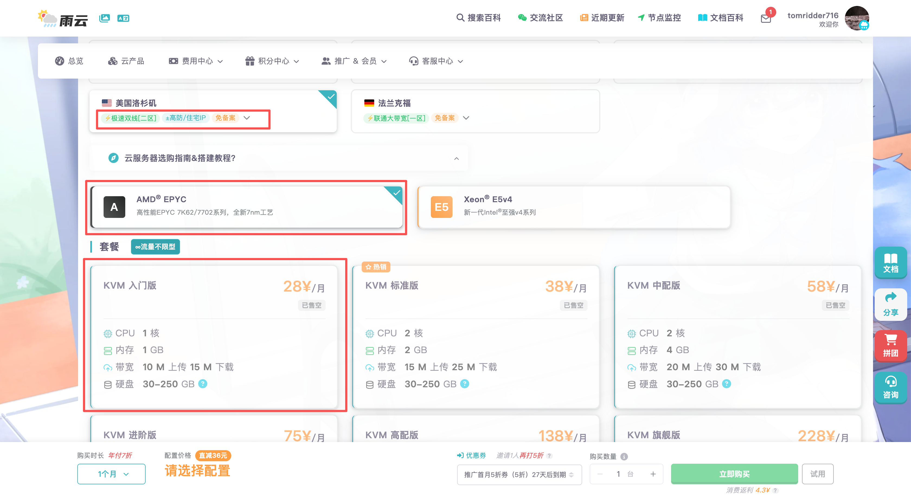
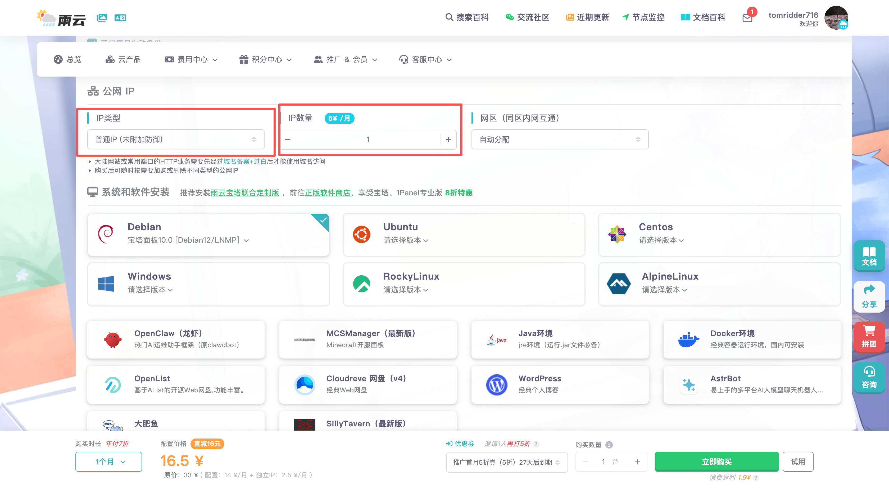

# Claude 账号 防封 / 自建代理全流程：VLESS-Reality + Hysteria2 + Clash Verge（含踩坑记录）

一台海外 VPS，两个协议、三个节点，电脑和手机一起全局代理。本文是我在一台洛杉矶 VPS（Debian 12，1 核 1G）上从零搭到可以长期使用的完整记录。附带一键安装脚本，也有逐步手动的做法，以及实际踩过的坑。

我通过这个方法 ，自己的ip在 [IP 检测工具 ](https://ip.net.coffee/claude/) 分数高达83分，且为美国固定ip。
自己的 Claude账号也坚持一个月没有被封。推荐各位读者研究部署。


> **声明**：本文仅用于个人学习网络技术和保护自身隐私。请遵守你所在地区的法律法规，不要用于任何违法用途，也不要拿来售卖或分享给他人使用。

---

## 目录

- [最终效果](#最终效果)
- [准备工作](#准备工作)
- [第一步：服务器安全初始化](#第一步服务器安全初始化)
- [第二步：一键安装（推荐）](#第二步一键安装推荐)
- [第二步（另一种做法）：手动安装](#第二步另一种做法手动安装)
- [第三步：电脑端 Clash Verge Rev](#第三步电脑端-clash-verge-rev)
- [第四步：手机端](#第四步手机端)
- [DNS 防泄露](#dns-防泄露)
- [验证与排障](#验证与排障)
- [踩坑记录（重点）](#踩坑记录重点)
- [日常维护](#日常维护)
- [仓库文件 / Claude Code Skill](#仓库文件--claude-code-skill)

---

## 最终效果

```
           ┌──────────────── VPS（海外） ────────────────┐
 电脑/手机 ─┼─ TCP 443  ── Xray  VLESS-Reality（伪装 www.nvidia.com）
 (Clash)   ├─ TCP 8443 ── Xray  VLESS-Reality（伪装 www.oracle.com）  ──► 互联网
           └─ UDP 443  ── Hysteria2 + salamander 混淆（伪装 www.bing.com）
```

| 节点 | 协议 | 端口 | 特点 |
|---|---|---|---|
| Reality | VLESS + REALITY + xtls-rprx-vision | **TCP 443** | 主力。不需要域名和证书，抗探测好 |
| Reality-8443 | 同上，换伪装站 | **TCP 8443** | 备用。443 被干扰时切这个 |
| Hy2 | Hysteria2 + salamander | **UDP 443** | 基于 QUIC。线路丢包大时速度往往最快，适合看视频 |

- TCP 443 和 UDP 443 是两个独立的端口，Xray 和 Hysteria2 可以同时监听，互不冲突。
- 客户端里有一个 `AUTO` 组（fallback）：按顺序用第一个能用的节点，坏了自动切下一个。还有一个 `PROXY` 组，可以手动选节点。
- 分流规则：国内网站直连，其他走代理。DNS 也做了防泄露。

实测数据（西安联通 → 洛杉矶）：三个节点延迟大约 220–530ms，在 ip.net.coffee 上显示出口 IP 是 VPS 的 IP，DNS 检测显示「未检测到泄露」。

---

## 准备工作

**VPS**
- 系统：Debian 11/12 或 Ubuntu 20.04+（脚本只支持 apt 系），需要 root 权限
- 配置：1 核 1G 就够个人使用
- 位置：美国，推荐美西的洛杉矶（离中国大陆近、延迟低）。线路（CN2 GIA / 9929 / CMI 等）比机器配置重要得多
- **443 端口不能被占用**：如果装了宝塔、nginx 并占用了 443，要么换端口，要么让出 443（查看命令：`ss -tlnp | grep :443`）
- 一定要有独立ip
- 推荐服务器厂家 -- [雨云服务器](https://www.rainyun.com/MTI3NjIz_)

<p>
  
  
</p>

**本地客户端**

| 平台 | 客户端 | 说明 |
|---|---|---|
| macOS / Windows | [Clash Verge Rev](https://github.com/clash-verge-rev/clash-verge-rev) | mihomo 内核，推荐 |
| Android | Clash Meta for Android / FlClash | 直接导入 yaml |
| iPhone | Shadowrocket 或 Stash | 都需要外区 Apple ID 购买 |

> ⚠️ **原版 ClashX / ClashX Pro 不支持 VLESS-Reality**，导入后会报错，必须用 mihomo（Clash Meta）内核的客户端。

---

## 第一步：服务器安全初始化

拿到 VPS 后，先把登录方式换成 SSH 密钥。**不要长期用 root 密码登录，也不要把密码发给任何人（包括 AI）。**

在**你自己的电脑**上：

```bash
# 没有密钥就先生成一把
ssh-keygen -t ed25519
# 把公钥装到服务器（这一步输入一次 root 密码）
ssh-copy-id -i ~/.ssh/id_ed25519.pub root@<服务器IP>
# 之后免密登录
ssh -i ~/.ssh/id_ed25519 root@<服务器IP>
```

确认密钥能登录以后，建议：

```bash
passwd                      # 修改 root 密码（尤其是密码曾经发给过别人时）
# 可选：禁用密码登录（先确认密钥登录没问题！）
sed -i 's/^#\?PasswordAuthentication.*/PasswordAuthentication no/' /etc/ssh/sshd_config
systemctl restart ssh
```

---

## 第二步：一键安装（推荐）

把仓库里的 `install.sh` 传到服务器上执行：

```bash
# 在本地
scp install.sh root@<服务器IP>:/root/
# 在服务器
bash /root/install.sh
```

也可以在服务器上直接运行：

```bash
bash <(curl -fsSL https://raw.githubusercontent.com/sunreview/reality-hy2-vpn/main/install.sh)
```

脚本会依次完成以下工作：
1. 检查 443/8443（TCP）和 443（UDP）有没有被其他程序占用
2. 安装**锁定版本**的 Xray（v26.6.27，原因见[踩坑记录](#踩坑记录重点)）和 Hysteria2
3. 随机生成 UUID、Reality 密钥对、shortId、Hy2 密码和混淆密码，并校验公私钥是否配对
4. 写入服务端配置，生成 Hy2 的自签证书
5. 如果 ufw 或 firewalld 已启用，自动放行端口（**不会替你开启防火墙**，避免把 SSH 锁在外面）
6. 开启 BBR，启动服务并设为开机自启
7. 在 `/root/vpn-client/` 下生成 `clash.yaml`（Clash 系列客户端直接导入）和 `links.txt`（分享链接）

**可选参数**（用环境变量传入）：

| 变量 | 默认值 | 说明 |
|---|---|---|
| `REALITY_PORT` / `REALITY_SNI` | `443` / `www.nvidia.com` | 主 Reality 节点 |
| `REALITY_PORT2` / `REALITY_SNI2` | `8443` / `www.oracle.com` | 备用节点，`0` 表示不创建 |
| `HY2_PORT` / `HY2_SNI` | `443` / `www.bing.com` | Hysteria2，`0` 表示不安装 |
| `NODE_PREFIX` | `VPS` | 客户端里显示的节点名前缀 |
| `XRAY_VERSION` / `HY2_VERSION` | `v26.6.27` / `v2.13.0` | 锁定的版本号 |
| `SERVER_IP` | 自动探测 | 公网 IPv4 |
| `FORCE` | `0` | `1` = 覆盖已有配置（会先备份） |
| `RENDER_ONLY` | `0` | `1` = 只生成配置文件，不安装也不改系统（用来测试） |

例：`NODE_PREFIX=LA REALITY_PORT2=0 bash install.sh`

装完后把客户端配置拉到本地：

```bash
scp root@<服务器IP>:/root/vpn-client/clash.yaml ./vpn.yaml
```

> ⚠️ **云厂商控制台里的「安全组 / 防火墙」要单独放行 TCP 443、TCP 8443、UDP 443。** 很多人卡在这一步：服务器内部一切正常，但包在云厂商那一层就被丢了。

---

## 第二步（另一种做法）：手动安装

想弄清每一步在做什么，就按下面手动操作。效果和脚本完全一样。

### 1. 安装 Xray（锁定版本）

```bash
bash -c "$(curl -fsSL https://github.com/XTLS/Xray-install/raw/main/install-release.sh)" @ install --version v26.6.27
xray version
```

### 2. 生成密钥

```bash
xray uuid            # → UUID
xray x25519          # → PrivateKey（填服务端）和 Password (PublicKey)（填客户端）
openssl rand -hex 8  # → shortId
```

> 新版 Xray 的 `x25519` 输出里，`Password (PublicKey)` 就是公钥；旧版写作 `Public key`。

### 3. 选 Reality 伪装站

伪装站（`dest` / `serverNames`）要满足以下条件：
- 支持 **TLS 1.3 + HTTP/2**
- 国内能正常访问，并且是大公司官网
- 最好不要被 CDN 过度重定向

检查方法：

```bash
curl -sI -m5 --tlsv1.3 --http2 https://www.nvidia.com -o /dev/null -w "%{http_version} %{http_code}\n"
# 输出 "2 200" 或 "2 301" 之类即可
```

我一开始用了 `www.apple.com`，Xray 启动时会给出警告，后来换成了 `www.nvidia.com`。备用节点用 `www.oracle.com`。

### 4. Xray 服务端配置

`/usr/local/etc/xray/config.json`：

```json
{
  "log": { "loglevel": "warning", "access": "none" },
  "inbounds": [
    {
      "listen": "0.0.0.0",
      "port": 443,
      "protocol": "vless",
      "settings": {
        "clients": [{ "id": "<UUID>", "flow": "xtls-rprx-vision" }],
        "decryption": "none"
      },
      "streamSettings": {
        "network": "tcp",
        "security": "reality",
        "realitySettings": {
          "dest": "www.nvidia.com:443",
          "serverNames": ["www.nvidia.com"],
          "privateKey": "<PrivateKey>",
          "shortIds": ["<shortId>"]
        }
      },
      "sniffing": { "enabled": true, "destOverride": ["http", "tls", "quic"], "routeOnly": true }
    },
    {
      "listen": "0.0.0.0",
      "port": 8443,
      "protocol": "vless",
      "settings": {
        "clients": [{ "id": "<UUID>", "flow": "xtls-rprx-vision" }],
        "decryption": "none"
      },
      "streamSettings": {
        "network": "tcp",
        "security": "reality",
        "realitySettings": {
          "dest": "www.oracle.com:443",
          "serverNames": ["www.oracle.com"],
          "privateKey": "<PrivateKey>",
          "shortIds": ["<shortId>"]
        }
      },
      "sniffing": { "enabled": true, "destOverride": ["http", "tls", "quic"], "routeOnly": true }
    }
  ],
  "outbounds": [
    { "protocol": "freedom", "tag": "direct" },
    { "protocol": "blackhole", "tag": "block" }
  ],
  "routing": {
    "rules": [{ "type": "field", "ip": ["geoip:private"], "outboundTag": "block" }]
  }
}
```

要点：
- `"access": "none"`：不记录访问日志，既保护隐私，也不会把小硬盘写满
- `geoip:private → block`：禁止通过代理访问服务器内网，比如本机的 MySQL 或宝塔面板
- 两个入站共用同一个 UUID、私钥和 shortId，只是端口和伪装站不同

```bash
xray run -test -c /usr/local/etc/xray/config.json   # 显示 Configuration OK 即可
systemctl enable --now xray && systemctl restart xray
```

### 5. 安装 Hysteria2

```bash
bash <(curl -fsSL https://get.hy2.sh/) --version v2.13.0

# 自签证书（CN 跟伪装站一致即可，客户端会跳过证书校验）
mkdir -p /etc/hysteria
openssl req -x509 -nodes -newkey ec -pkeyopt ec_paramgen_curve:prime256v1 \
  -keyout /etc/hysteria/server.key -out /etc/hysteria/server.crt \
  -subj "/CN=www.bing.com" -days 3650
chown hysteria:hysteria /etc/hysteria/server.key /etc/hysteria/server.crt
chmod 600 /etc/hysteria/server.key

openssl rand -hex 16   # → Hy2 密码
openssl rand -hex 16   # → 混淆密码
```

`/etc/hysteria/config.yaml`：

```yaml
listen: :443            # UDP 443，和 Xray 的 TCP 443 不冲突
tls:
  cert: /etc/hysteria/server.crt
  key: /etc/hysteria/server.key
auth:
  type: password
  password: <Hy2密码>
obfs:                   # salamander 混淆：让 QUIC 流量看起来不像 QUIC，减少被 QoS
  type: salamander
  salamander:
    password: <混淆密码>
masquerade:             # 不带正确密码的访问会被反代到 bing，看起来像个普通网站
  type: proxy
  proxy:
    url: https://www.bing.com
    rewriteHost: true
```

```bash
systemctl enable --now hysteria-server && systemctl restart hysteria-server
```

### 6. 防火墙

```bash
ufw allow 22/tcp      # ⚠️ 一定先放行 SSH（端口改过的话用你自己的端口）
ufw allow 443/tcp
ufw allow 8443/tcp
ufw allow 443/udp     # Hysteria2 走 UDP，别忘了
ufw enable            # 原本没开 ufw 的话再执行这句
ufw status
```

云厂商控制台的安全组也要放行这些端口（见上文）。

### 7. BBR

```bash
sysctl net.ipv4.tcp_congestion_control   # 已经是 bbr 就跳过
echo -e "net.core.default_qdisc=fq\nnet.ipv4.tcp_congestion_control=bbr" > /etc/sysctl.d/99-bbr.conf
sysctl --system
```

### 8. 自检

```bash
systemctl is-active xray hysteria-server     # 两个都应该是 active
ss -tlnp | grep -E ':443|:8443'              # xray 在监听 TCP
ss -ulnp | grep ':443'                       # hysteria 在监听 UDP
journalctl -u xray -n 30 --no-pager          # 看有没有报错
```

---

## 第三步：电脑端 Clash Verge Rev

### 安装

- macOS：`brew install --cask clash-verge-rev`，或者到 [Releases](https://github.com/clash-verge-rev/clash-verge-rev/releases) 下载 dmg
- Windows：同一个 Releases 页面下载 exe

### 导入配置

「订阅」→「新建」→ 类型选**本地**，选择 `vpn.yaml` → 保存，然后点一下这个配置，让它变成当前配置（高亮）。

### 两种代理方式

| 方式 | 作用 | 设置 |
|---|---|---|
| 系统代理 | 浏览器和大部分遵守系统代理的 App 走代理 | 「设置」→ 打开「系统代理」 |
| **TUN（虚拟网卡）** | **所有流量都走代理**，包括终端、游戏、不认系统代理的 App | 「设置」→ 先「安装服务」（要输入管理员密码）→ 再打开「虚拟网卡模式」 |

想要「全部流量都走代理」，就开 TUN。TUN 需要先装好服务模式，不然开关打不开。

「规则」和「全局」的区别：**规则**模式下国内直连、国外走代理（推荐日常使用）；**全局**模式下所有网站都走代理（排查问题时用）。

### 客户端配置完整说明

脚本生成的 `clash.yaml`（手动搭建的话照抄这份，把 `<...>` 换成自己的值）：

```yaml
mixed-port: 7890
allow-lan: false
mode: rule
log-level: info
ipv6: false                  # VPS 只用 IPv4，客户端关掉 IPv6，避免 v6 流量绕过代理
unified-delay: true
tcp-concurrent: true
geox-url:                    # 规则数据库走 jsDelivr 镜像，国内也能下载
  geoip: https://testingcf.jsdelivr.net/gh/MetaCubeX/meta-rules-dat@release/geoip.dat
  geosite: https://testingcf.jsdelivr.net/gh/MetaCubeX/meta-rules-dat@release/geosite.dat
  mmdb: https://testingcf.jsdelivr.net/gh/MetaCubeX/meta-rules-dat@release/country.mmdb

dns:                         # 详见下面的「DNS 防泄露」
  enable: true
  ipv6: false
  enhanced-mode: fake-ip
  fake-ip-range: 198.18.0.1/16
  fake-ip-filter: ['*.lan', '*.local', '+.msftconnecttest.com', '+.msftncsi.com', 'time.*.com', 'ntp.*.com']
  respect-rules: true
  default-nameserver: [223.5.5.5, 119.29.29.29]
  proxy-server-nameserver: [https://223.5.5.5/dns-query, https://doh.pub/dns-query]
  nameserver: [https://1.1.1.1/dns-query, https://8.8.8.8/dns-query]
  nameserver-policy:
    'geosite:cn,private': [https://223.5.5.5/dns-query, https://doh.pub/dns-query]

proxies:
  - name: VPS-Reality
    type: vless
    server: <服务器IP>
    port: 443
    uuid: <UUID>
    network: tcp
    tls: true
    udp: true
    flow: xtls-rprx-vision
    servername: www.nvidia.com       # 必须和服务端 serverNames 一致
    client-fingerprint: chrome       # Reality 必填
    reality-opts:
      public-key: <PublicKey>        # 公钥！不是私钥
      short-id: <shortId>

  - name: VPS-Reality-8443
    type: vless
    server: <服务器IP>
    port: 8443
    uuid: <UUID>
    network: tcp
    tls: true
    udp: true
    flow: xtls-rprx-vision
    servername: www.oracle.com
    client-fingerprint: chrome
    reality-opts:
      public-key: <PublicKey>
      short-id: <shortId>

  - name: VPS-Hy2
    type: hysteria2
    server: <服务器IP>
    port: 443
    password: <Hy2密码>
    obfs: salamander
    obfs-password: <混淆密码>
    sni: www.bing.com
    skip-cert-verify: true           # 自签证书，必须跳过校验

proxy-groups:
  - name: PROXY                      # 手动选节点
    type: select
    proxies: [AUTO, VPS-Reality, VPS-Reality-8443, VPS-Hy2, DIRECT]
  - name: AUTO                       # 按顺序用第一个可用的，坏了自动切
    type: fallback
    url: https://www.gstatic.com/generate_204
    interval: 300
    proxies: [VPS-Reality, VPS-Reality-8443, VPS-Hy2]

rules:
  - GEOIP,LAN,DIRECT,no-resolve
  - GEOSITE,cn,DIRECT
  - GEOIP,CN,DIRECT,no-resolve
  - MATCH,PROXY
```

> Clash Verge 会用自己「设置」里的端口覆盖 `mixed-port`（默认 7897）。实际端口以 Clash Verge 设置里显示的为准。

---

## 第四步：手机端

### Android：Clash Meta for Android

把 `clash.yaml` 传到手机上有两种办法：

**办法 A（推荐）：局域网临时下载**。电脑和手机连同一个 Wi‑Fi，在电脑上配置文件所在目录执行：

```bash
python3 -m http.server 8899 --bind <电脑的局域网IP>
```

手机上打开 Clash Meta →「配置」→「新配置」→「URL」，填 `http://<电脑的局域网IP>:8899/vpn.yaml` → 保存，选中后回首页启动。
**导入完马上在电脑上按 Ctrl+C 关掉**，因为这个文件里有全部密钥。

**办法 B**：用微信或 USB 把文件传到手机，然后在「新配置」里选「文件」。

建议的设置：「网络」→ 关闭「允许应用绕过」；「访问控制」选所有应用；IPv6 保持关闭。

### iPhone

**Shadowrocket**：复制 `links.txt` 里的三条链接，打开 Shadowrocket，它会自动识别剪贴板并提示添加。也可以点右上角「+」→ 类型选「从剪贴板导入」。

链接里不包含 DNS 设置，防泄露要单独处理：
- 最简单：「全局路由」选**代理**，所有流量（包括 DNS）都从 VPS 出去，代价是国内网站也会绕道
- 想保留国内直连：「配置」→ 编辑当前配置 →「DNS 服务器」改成 `https://1.1.1.1/dns-query, https://8.8.8.8/dns-query`，「全局路由」选**配置**

**Stash**：可以直接导入 `clash.yaml`，导入方法同 Android 的办法 A，用 Safari 打开局域网地址即可。

> iPhone 部分我没有完整实测。不管用哪种方式，配好后都要用下面的方法检测一次 DNS 是否泄露。

---

## DNS 防泄露

**现象**：IP 检测网站显示出口 IP 是 VPS，但「DNS 出口」是国内运营商（比如「中国联通」）。这说明你访问了哪些网站，国内 DNS 都能看到，网站也能据此判断出你的真实地区。

**原因**：默认配置下，客户端要先解析域名，才能判断该走直连还是代理，而解析用的是国内 DNS。

**修复**（就是上面 yaml 里的 `dns:` 段）：
- `respect-rules: true`：DNS 查询本身也按规则分流，国外 DoH（1.1.1.1 / 8.8.8.8）的查询通过代理从 VPS 发出
- `nameserver-policy` 里 `geosite:cn` 用国内 DoH：国内网站仍然解析到国内 CDN，速度不受影响
- `rules` 里 GEOIP 规则加 `no-resolve`：判断规则时不会为了查 IP 而提前去解析域名
- `fake-ip`：应用拿到的是假 IP，真正的解析交给代理端完成

**检测**：打开 <https://ip.net.coffee/claude/>（或 ipleak.net、browserleaks.com/dns），看到「未检测到泄露」、DNS 出口是境外 IP 就对了。

> 用 `whoami.akamai.net` 这类方法测，可能仍然显示国内 DNS。原因是 `akamai.net` 在 `geosite:cn` 列表里，会按规则走国内 DNS，属于正常现象，不算泄露。

---

## 验证与排障

**macOS 一键自检**（端口连通性、各节点真实延迟、经代理的出口 IP）：

```bash
SERVER=<服务器IP> bash scripts/mac-check.sh
```

正常输出类似：

```
TCP 443: OK
TCP 8443: OK
VPS-Hy2: {"delay":221}
VPS-Reality: {"delay":489}
VPS-Reality-8443: {"delay":527}
经代理(:7897)出口 IP : <服务器IP>
```

**排障顺序**：
1. 端口 FAILED：检查云厂商安全组、ufw，以及服务有没有在跑（`systemctl is-active xray`）
2. 端口 OK 但节点超时：在服务端执行 `journalctl -u xray -f`，然后在客户端点一下测速
   - 服务端**完全没日志**：包没有到达服务器，检查本地是否有别的 VPN 在抢流量
   - 服务端出现 `REALITY: processed invalid connection ... authentication failed`：见下面踩坑记录 1 和 2
3. Hy2 不通但 Reality 正常：UDP 443 没放行，或者本地网络或运营商封了 UDP（部分公司和校园网会这样）

---

## 踩坑记录（重点）

| # | 现象 | 原因 | 解决 |
|---|---|---|---|
| 1 | Clash（mihomo）连 Reality 全部失败，服务端报 `REALITY: processed invalid connection ... authentication failed`，**但官方 Xray 客户端能连** | Xray 服务端 **≥ v26.7.11** 和 mihomo v1.19.33 的 Reality 握手不兼容。我在服务端逐个版本二分测试过：v26.6.27 正常，v26.7.11 / v26.7.28 / v26.9.x 都失败 | **服务端锁定 Xray v26.6.27**。不要随手运行升级脚本，升级前先用 Clash 客户端实测 |
| 2 | 同样报 `authentication failed`，或者节点全部超时 | **本地还开着别的 VPN**（我遇到的是某商业 VPN 的 TUN 网卡，而且它退出后会自己重启），它会按 SNI 劫持 Clash 发出的连接 | 彻底退出其他 VPN，用 `ifconfig` / `scutil --nc list` 确认，再用 `mac-check.sh` 测 |
| 3 | 原版 ClashX 导入配置报错 | 原版 ClashX 内核太老，不支持 VLESS-Reality | 换 Clash Verge Rev 或其他 mihomo 内核的客户端 |
| 4 | 在配置里加了 `access`/`error` 日志文件路径后，Xray 起不来 | 日志文件被 root 创建，Xray 服务以 `xray`/`nobody` 用户运行，没有写权限 | `chown -R xray: /var/log/xray`（用户名以 `systemctl show -p User xray` 为准），或者干脆不写日志文件 |
| 5 | Xray 启动时对伪装站给出警告 | 选的伪装站（`www.apple.com`）不太合适 | 换成支持 TLS1.3 + H2 的站点，比如 `www.nvidia.com` |
| 6 | Clash Verge 的 TUN 开关打不开 | 没装服务模式（重装 App 后服务也会被删除） | 「设置」→「安装服务」，输入管理员密码 |
| 7 | 出口 IP 正确，DNS 却显示国内运营商 | DNS 泄露 | 见 [DNS 防泄露](#dns-防泄露) |
| 8 | 第一次启动卡住或报 geosite 下载失败 | 默认从 GitHub 下载规则库，国内访问慢 | `geox-url` 换成 jsDelivr 镜像（配置里已经写好） |
| 9 | 节点在服务器内部测试全通，外面却连不上 | 云厂商安全组没有放行 | 到控制台放行 TCP 443/8443 和 UDP 443 |
| 10 | Hy2 节点报证书错误 | 自签证书 | 客户端设置 `skip-cert-verify: true`（分享链接里对应 `insecure=1`） |
| 11 | 装了宝塔或 nginx 后 Reality 起不来 | 443 被 nginx 占用 | `ss -tlnp \| grep :443` 查看；让出 443，或者给 Reality 换端口 |

另外两条经验：
- **Google Play「添加付款方式」提示无网络**：这通常不是代理的问题。Play 付款对 IP（机房 IP 风控）、付款资料所属国家和卡片地区都有要求，这类问题换节点基本解决不了。
- **IP 检测网站提示时区或语言是中国**：这是浏览器和系统层面的信息，代理改变不了。在意的话，自己改系统时区和浏览器语言。

---

## 日常维护

- **不要随手升级 Xray**（见踩坑记录 1）。服务器上的 `/usr/local/etc/xray/PINNED-VERSION.txt` 写有说明。
- **更换密钥**（怀疑配置泄露时）：执行 `FORCE=1 bash install.sh` 重新生成一套密钥，旧配置会自动备份，然后在客户端重新导入 `clash.yaml`。
- **备份**：`/usr/local/etc/xray/config.json` 和 `/etc/hysteria/` 两处。
- **服务状态**：`systemctl status xray hysteria-server`。两个服务都设了开机自启，VPS 重启后会自动恢复。
- **VPS 续费**：VPS 到期，代理就没了。记得在服务商控制台查看到期时间，或者开启自动续费。
- **配置文件就是密钥**：`clash.yaml` 和分享链接不要发到群里，不要截图分享，也不要提交到 Git。

---

## 仓库文件 / Claude Code Skill

```
.
├── README.md                     # 本文
├── LICENSE                       # MIT
├── install.sh                    # 服务端一键安装（Debian/Ubuntu）
├── scripts/
│   └── mac-check.sh              # macOS 客户端自检
└── skill/
    └── self-hosted-vpn/          # Claude Code Skill
        ├── SKILL.md
        └── scripts/              # install.sh、mac-check.sh 的副本
```

**Claude Code Skill**：把 `skill/self-hosted-vpn` 复制到 `~/.claude/skills/`，以后在 Claude Code 里说「帮我在 x.x.x.x 上搭一个自用 VPN」，它就会按本文的流程执行：先确认 SSH 密钥登录（不会要你的密码），然后预检端口、运行安装脚本、导入 Clash Verge、测速，最后检查 DNS 泄露。

```bash
cp -r skill/self-hosted-vpn ~/.claude/skills/
```

`install.sh` 在发布前用 `RENDER_ONLY=1` 模式在真实 VPS 上做过端到端测试：用生成的服务端配置在测试端口上启动 Xray 和 Hysteria2，再用 mihomo v1.19.33 加载生成的 `clash.yaml`，三个节点全部连通，经代理访问 Google 返回 200。

## Claude Pro 免kyc 成品号
如果大家找不到合适的渠道购买 Claude 普号 和 Claude Pro 会员成品号，可以查看 [AI杂货铺](https://store.ai-headshot.net/)
这里配备了可以接码登陆的Claude普号，以及不用国外信用卡就可以轻松购买 Claude Pro 免kyc 成品号。


## 致谢

- [XTLS/Xray-core](https://github.com/XTLS/Xray-core) · [apernet/hysteria](https://github.com/apernet/hysteria) · [MetaCubeX/mihomo](https://github.com/MetaCubeX/mihomo) · [clash-verge-rev](https://github.com/clash-verge-rev/clash-verge-rev) · [MetaCubeX/meta-rules-dat](https://github.com/MetaCubeX/meta-rules-dat)

## License

[MIT](LICENSE)
